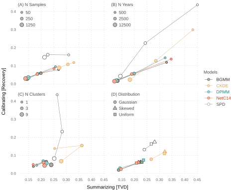

```{r}
#| label: prepare-results
evaluation_results <- transform(
  evaluation_results,
  recovery = (crps - crps_oracle) / crps_oracle
)
```

These visualizations emphasize that radiocarbon dating is a multi-objective
problem involving calibration (or age estimation) and summarization (or density
estimation) and that these objectives can sometimes trade-off each other,
especially for mixture models where there is non-identifiability. The x-axis
measures how well a model does at *summarizing* dates (at estimating the true
density). TVD refers to "Total Variation Distance", which measures distance
between two probability distributions. The y-axis measures how well a model does
at *calibrating* dates (at estimating the true age of each sample). CRPS is the
"Continuous Ranked Probability Score", which is like the mean absolute error of
the posterior age draws, but with a penalty for overconfidence, so a model
cannot improve its score by making its posteriors narrower.

Recovery refers to the proportional excess error in calibration over an
"oracle" model that knows the true age distribution or chronology.

$$
\rho = \frac{\text{Model} - \text{Oracle}}{\text{Oracle}}
$$

The idea behind recovery is to establish a baseline for model performance, like
even if you knew the true density, how much error would remain in trying to
estimate ages given calibration curve and measurement uncertainty? Because CRPS
is a proper scoring rule, the oracle is optimal in expectation, so recovery
should be non-negative on average, though sampling noise means a model can
occasionally beat the oracle in a single simulation.

**Summary**

Mean values across all simulations for each model.

```{r}
#| label: evaluation-summary
aggregate(
  cbind(tvd, wd, mae, mse, crps, lp, recovery, elapsed) ~ model,
  FUN = \(x) round(mean(x), 3),
  data = evaluation_results
)
```

**Simulation Parameters**

Points are median values across simulations for each level of a simulation
parameter. All panels share the same axes.

```{r}
#| label: plot-evaluate-objectives
#| code-fold: true
#| output: false
panels <- list(
  n_samples = list(
    title = "(A) N Samples",
    levels = c(50, 250, 1250),
    labels = c(50, 250, 1250),
    cex = c(0.9, 1.2, 1.6),
    pch = c(21, 21, 21)
  ),
  n_years = list(
    title = "(B) N Years",
    levels = c(500, 2500, 12500),
    labels = c(500, 2500, 12500),
    cex = c(0.9, 1.2, 1.6),
    pch = c(21, 21, 21)
  ),
  n_clusters = list(
    title = "(C) N Clusters",
    levels = c(1, 3, 9),
    labels = c(1, 3, 9),
    cex = c(0.9, 1.2, 1.6),
    pch = c(21, 21, 21)
  ),
  distribution = list(
    title = "(D) Distribution",
    levels = c("gaussian", "skewed", "uniform"),
    labels = c("Gaussian", "Skewed", "Uniform"),
    cex = c(1.2, 1.2, 1.2),
    pch = c(21, 24, 22)
  )
)

xy <- sapply(
  names(panels),
  \(nm) {
    aggregate(
      evaluation_results[c("tvd", "recovery")],
      by = evaluation_results[c("model", nm)],
      FUN = median
    )
  },
  simplify = FALSE
)

xlim <- range(unlist(lapply(xy, `[[`, "tvd")))
ylim <- range(unlist(lapply(xy, `[[`, "recovery")))

svglite(
  filename = "figures/evaluate-objectives.svg",
  width = 6.5,
  height = 5.3
)

layout(
  matrix(c(1, 2, 5, 3, 4, 5), nrow = 2, byrow = TRUE),
  widths = c(2.85, 2.6, 0.8),
  heights = c(2.6, 2.65)
)

par(defaults)
par(omi = c(0.25, 0.2, 0, 0.05))

for (k in seq_along(panels)) {
  nm <- names(panels)[k]
  p <- panels[[k]]
  is_left <- k %in% c(1, 3)
  is_bottom <- k %in% c(3, 4)

  par(
    mai = c(
      if (is_bottom) 0.2 else 0.15,
      if (is_left) 0.3 else 0.05,
      0.05,
      0.05
    )
  )

  new_plot(xlim, ylim)
  add_grid()

  for (mdl in unique(xy[[nm]][["model"]])) {
    i <- which(xy[[nm]][["model"]] == mdl)
    x <- xy[[nm]][["tvd"]][i]
    y <- xy[[nm]][["recovery"]][i]
    j <- match(as.character(xy[[nm]][[nm]][i]), p$levels)

    clr <- theme(mdl)
    cbg <- if (mdl == "SPD") "#FFFFFF" else theme(mdl, shade = -0.6)

    lines(x, y, col = clr, lwd = 0.5)
    points(x, y, pch = p$pch[j], col = clr, bg = cbg, cex = p$cex[j])
  }

  if (is_bottom) {
    x_axis()
  }
  if (is_left) {
    y_axis()
  }

  if (k == 3) {
    mtext(
      "Summarizing [TVD]",
      side = 1,
      line = 1.5,
      at = par("usr")[2],
      xpd = NA,
      col = par("col.lab"),
      cex = par("cex.lab")
    )

    mtext(
      "Calibrating [Recovery]",
      side = 2,
      line = 1.8,
      at = par("usr")[4],
      xpd = NA,
      col = par("col.lab"),
      cex = par("cex.lab")
    )
  }

  add_legend(
    x = "topleft",
    legend = p$labels,
    pt.bg = coolors("gray", shade = -0.6),
    col = coolors("gray"),
    text.col = coolors("gray"),
    pch = p$pch,
    pt.cex = p$cex,
    inset = c(0, 0.06),
    title = p$title
  )
}

par(mai = rep(0, 4))
new_plot(c(0, 1), c(0, 1))
add_legend(
  x = 0,
  y = 0.6,
  legend = c("BGMM", "CKDE", "DPMM", "NetC14", "SPD"),
  pt.bg = c(theme("BGMM", "CKDE", "DPMM", "NetC14", shade = -0.6), "#FFFFFF"),
  col = theme("BGMM", "CKDE", "DPMM", "NetC14", "SPD"),
  text.col = theme("BGMM", "CKDE", "DPMM", "NetC14", "SPD"),
  pch = 21,
  pt.cex = 1.1,
  lwd = 0.5,
  title = "Models"
)

dev.off()
```

::: {#evaluate-objectives}

:::

