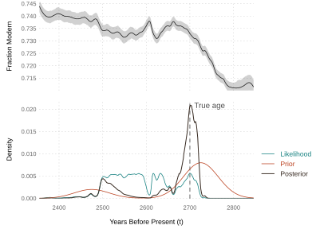
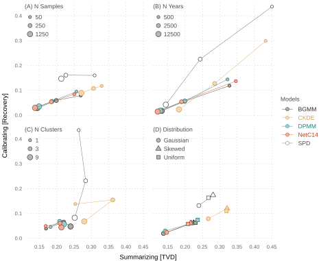
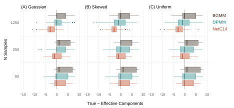
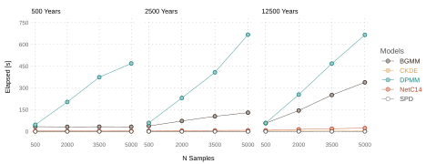
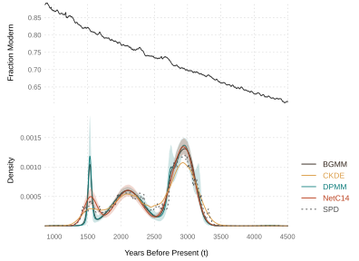
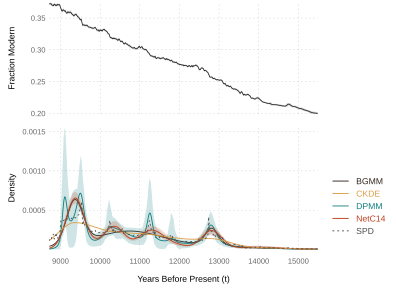

```{=typst}
#set math.cases(gap: 0.8em)
```

## Introduction

Archaeological radiocarbon (^14^C) dating has two primary objectives: (i) to
estimate the true ages of a set of organic samples and (ii) to reconstruct the
true calendar age distribution $p(t)$ from which those samples are drawn, with
the latter serving as a proxy for population size over time. The first objective
was established by the chemist Willard Libby in the late 1940s [@libby1946], the
second by the archaeologist John Rick four decades later [@rick1987]. Among
archaeologists, a common strategy for achieving them is to first estimate the
ages of samples individually and only then bring them together to reconstruct
the distribution from which the samples are drawn, typically by summing the
posterior probabilities of the individual age estimates, the Summed Probability
Distribution (SPD) method [@blockley2000; @crema2022]. Unfortunately, SPD
estimates are noisy [@brown2015] and statistically incoherent, summing
posteriors with contradictory priors [@heaton2022; @carleton2021; @crema2022].

Recently, however, @heaton2022 and @price2021 have proposed an alternative
Bayesian strategy, pursuing both radiocarbon dating objectives simultaneously,
estimating ages and the chronology they are drawn from at the same time using
latent variable models. To the extent that their approaches differ, it is in the
specification of $p(t)$. @price2021 recommend a parametric Bayesian Gaussian
Mixture Model (BGMM), @heaton2022 a non-parameteric Dirichlet Process Mixture
Model (DPMM), with the latter learning the number of Gaussian mixture components
during model training. Here we propose a third mixture model, a Gaussian Mixture
Neural Network that we call NetC14. NetC14 is quasi-parametric as it begins with
an initially over-specified number of Gaussian components, then uses a SparseMax
activation [@martins-astudillo-2016] on mixture weights to prune components out
of the model.

As a proof of concept, we evaluate the ability of NetC14 to calibrate and
summarize radiocarbon dates using simulated data, comparing its performance to
that of the other mixture models - BGMM and DPMM - plus two traditional
approaches - SPD and Composite Kernel Density Estimation (CKDE). We also apply
all models to real datasets used in @heaton2022 and @bronkramsey2017. Our
results show that a minimal specification of NetC14 - severely limited in its
complexity and implementation - is already competitive with the state of the
art, but substantially more computationally efficient and scalable to larger
datasets, and that is before harnessing GPU acceleration and other
optimizations. NetC14 also comes with all the advantages of neural networks,
making it highly flexible and adaptable to a wide variety of data,
archaeological and otherwise, which we discuss below.

## Background

In this section, we review the Bayesian logic of the mixture models. For more
background on archaeological radiocarbon dating, see
[@bronkramsey2008; @bayliss2009; @hajdas2021; @taylor2016; @wood2015]. For
detail on how these probabilities are estimated with matrix algebra in R, see
Supplement A (Introduction).

### Generative Model

Our data consist of fraction modern radiocarbon measurements, a dimensionless
unit comparing the ^14^C/^12^C ratio in organic samples to a modern reference
standard of atmospheric carbon levels in 1950 [@mcnichol2001]. Adapting
@heaton2022 to this fraction modern context, we define the generative model for
radiocarbon measurements $F_{i}$ on $i = 1, ..., n$ organic samples as

$$
\begin{aligned}
  t_{1}, ..., t_{n} & \sim p(t) \\
  F_{i}             & \sim N(c(t_{i}), z_{i}^{2})
\end{aligned}
$$ {#eq-generative-model}

where $t_{1}, ..., t_{n}$ are the true but unknown ages of the $n$ samples drawn
from the age distribution $p(t)$, $c(t)$ is the fraction modern predicted by a
radiocarbon calibration curve for a given age $t$, and $z_{i}$ is the standard
deviation of the measured fraction modern for sample $i$. In plain English, we
might think of this generative model as answering two archaeological questions.
First, how likely is it that someone in the past did something at a particular
time and place that leaves some organic material behind, like butchering a deer
or chopping down a tree? That is a random draw of a calendar age $t_{i}$ from
$p(t)$. Second, assuming that organic material preserves over the intervening
years, how much ^14^C should we expect to find in it relative to a modern
reference standard when we actually get around to measuring it? That observation
is a random draw of a fraction modern measurement $F_{i}$ from
$N(c(t_{i}), z_{i}^{2})$, a Gaussian measurement model that incorporates
uncertainty from both the measurements and the calibration curve.

We denote uncertainty in the calibration curve itself for a given age $t$ as

$$
c(t) \mid t \sim N(\mu_{c}(t), \sigma_{c}(t)^{2})
$$ {#eq-calibration-curve}

with $\mu_{c}(t)$ and $\sigma_{c}(t)$ being the point-wise means and standard
deviations of Gaussians defined by the calibration curve. Conventionally, these
quantities are expressed as ^14^C ages, but we assume that they have been
converted to fraction modern using the mean-life function for radiocarbon. Given
that $F_{i}$ are also sampled from a Gaussian, the curve can be marginalized
over, such that

$$
F_{i} \mid t_{i} \sim N(\mu_{c}(t_{i}), \sigma_{c}(t_{i})^{2} + z_{i}^{2})
$$ {#eq-measurement-likelihood}

which shows that uncertainty propagates through the calibration curve and into
the measurements.

### Bayesian Mixture Models

The mixture models evaluated in this paper seek to reconstruct the calendar age
distribution $p(t)$ by conditioning on the mixture parameters
$\theta = \{w_{k}, \mu_{k}, \sigma_{k}\}$ (the weights, means, and standard
deviations) of $k = 1, ..., K$ clusters or component distributions $f$

$$
p(t \mid \theta) = \sum_{k=1}^{K} w_{k} \hspace{2pt} f(t \mid \mu_{k}, \sigma_{k}^2)
$$ {#eq-mixture-density}

where the weights must sum to one and $f$ is typically specified as a Gaussian.
The use of mixture models is interesting here for a number of reasons. First,
they are universal approximators, capable of reconstructing any continuous
density function provided they have a sufficient number of component
distributions, though naturally that comes with the risk of over-fitting
[@li1999; @mclachlan2000; @mclachlan2019]. They are relatively straightforward
to grasp, too, especially if one already understands how SPD models are fit, as
they both involve summing probability distributions. Finally, the latent
clustering assignments are open to a great deal of archaeological interpretation -
or over-interpretation as the case may be.

In a Bayesian context, we aim to estimate the mixture parameters $\theta$ by
sampling from their posterior probability given the observed fraction modern
measurements $F$, that is

$$
p(\theta \mid F) \propto p(F \mid \theta) \hspace{2pt} p(\theta)
$$ {#eq-mixture-posterior}

with $p(F \mid \theta)$ being the likelihood of the measurements given the
mixture parameters, what we refer to as the *mixture likelihood*, and
$p(\theta)$ the prior probability of the parameters. To sample from this
posterior, we need to (i) define the mixture likelihood $p(F \mid \theta)$ and
(ii) specify the priors $p(\theta)$ for the set of weights, means, and standard
deviations of the mixture model. We will elaborate on the priors in @heaton2022
and @price2021 in the methods section. For now, the likelihood function warrants
some attention.

To define the likelihood, we first define the joint probability of an observed
fraction modern measurement $F_{i}$ and its calendar age $t_{i}$ as

$$
p(F_{i}, t_{i} \mid \theta) = p(F_{i} \mid t_{i}) \hspace{2pt} p(t_{i} \mid \theta)
$$ {#eq-joint-probability}

where
$p(F_{i} \mid t_{i}) = N(F_{i} \mid \mu_{c}(t_{i}), \sigma_{c}(t_{i})^{2} + z_{i}^{2})$
is the likelihood of a measurement conditioned on its calendar age, what we
refer to as the *measurement likelihood*, and $p(t_{i} \mid \theta)$ is the
mixture density estimated by the mixture model at $t_{i}$. This encapsulates the
generative model, weighting the probability of obtaining measurements $F_{i}$
with ages $t_{i}$ by the prior probability of those ages. Note that we drop
$\theta$ from the measurement likelihood since once we know a sample's age, the
mixture tells us nothing more about its measurement. We also assume the
measurements are conditionally independent given their ages, ignoring
correlation induced by marginalizing over the shared calibration curve.

Because we do not know the true ages, however, we consider all possible ages
instead, thus evaluating the likelihood for sample $i$ as

$$
p(F_{i} \mid \theta) = \int p(F_{i} \mid t) \hspace{2pt} p(t \mid \theta) \hspace{2pt} dt
$$ {#eq-mixture-likelihood}

As @price2021 show, this integral can be approximated using Riemann sums. One
first evaluates the measurement likelihood $p(F_{i} \mid t)$ over an annually
resolved grid of $m$ years. Repeating this procedure for each of the $n$ samples
results in an $n \times m$ measurement matrix $\mathbf{M}$ whose rows are
measurement likelihoods for the samples given the calibration curve. One then
evaluates the mixture density $p(t \mid \theta)$ over the same grid of $m$ years
to produce a length-$m$ column-vector $\mathbf{v}$. Taking the matrix product

$$
\mathbf{h} = \mathbf{Mv}
$$ {#eq-sample-likelihoods}

(equation 14 in @price2021) gives the vector of sample likelihoods $\mathbf{h}$,
where the product of its elements is the total likelihood (the sum of their logs
being the log-likelihood). This compact expression shows that just two data
structures are needed to estimate the full mixture likelihood: a matrix
$\mathbf{M}$ of measurement likelihoods and a vector $\mathbf{v}$ of probability
densities. Any model that can estimate $\mathbf{v}$ can, thus, be fit using
Maximum Likelihood (e.g., @timpson-etal-2020).

::: {#fig-example-age}


Radiocarbon calibration with measurement likelihood $p(F \mid t)$ weighted by
the mixture density $p(t \mid \theta)$, which acts as an informative prior
concentrating posterior probability mass near modes of the mixture density and
also, as a consequence, around the true age of the sample. The calibration curve
is plotted above with a gray ribbon for the 95% confidence interval.
:::

### Posterior Age Estimation

According to Bayes' Theorem, the probability density of the posterior age
distribution is

$$
p(t \mid F, \theta) = \frac{p(F \mid t) \hspace{2pt} p(t \mid \theta)}{p(F \mid \theta)}
$$ {#eq-posterior-age}

In words, we weight the measurement likelihood for each sample by the mixture
distribution and then normalize with the mixture likelihood. This is equivalent
to multiplying each row of $\mathbf{M}$ elementwise by $\mathbf{v}$, and then
normalizing each row to sum to one (Supplement A, Example). Weighting in that
way has the effect of pulling the probability mass of each sample toward the
modes of the mixture density, as shown in @fig-example-age, with the consequence
that scalar estimates for each sample will be drawn more often from those
periods, thus providing a Bayesian means of overcoming multi-modality in the
calibration curve.

## Methods

For this analysis, we rely on the IntCal20 calibration curve
[@reimer2020; @heaton2020]. The analysis is conducted in the R programming
language and environment, v4.5.0 [@rcore2025], with the actual analysis
requiring just three packages: `torch` [@falbel2026], `carbondate`
[@heaton2022; @heaton2024], and `parallel`. Computations are run on a personal
computer with Windows 11, using a 12th Gen Intel(R) Core i9-12900KF with 16
cores and 64 GB RAM. Code and data can be found at the Zenodo archive
[@vernon-2026] and at the GitHub repository *kbvernon/netc14*.

### Simulations

To compare models, we rely on both simulated and empirical data. Each simulation
requires that we specify four variables: the number of clusters $K$, the kind of
distribution $f$, the number of samples $n$, and the number of years $m$ over
which to simulate a discretized calendar age distribution $\mathbf{v}$. Their
possible values are $K = \{1, 3, 9\}$,
$f = \{\textrm{Gaussian, Uniform, Skewed}\}$, $m = \{500, 2500, 12500\}$, and
$n = \{50, 250, 1250\}$. The three distributions represent clusters that are
symmetric, flat, and asymmetric, the last rising quickly and falling slowly or
the reverse (the Skewed distribution is a Gamma reflected at random). We choose
these values to achieve a range well beyond what previous studies have
attempted, making tests considerably more challenging. Every combination of
these variables is evaluated resulting in $3^4 = 81$ unique starting conditions
or *scenarios*. For each scenario, a start date $t_{min}$ is randomly sampled
from a discrete uniform on the interval from 0 to $(55000 - m)$ years before
present (ybp, with present = 1950) so that the end date
$t_{max} = t_{min} + m - 1$ never exceeds the upper limit on radiocarbon dating.
All 81 scenarios are repeated 28 times, each with a unique start date, resulting
in 2268 total simulations spread out randomly across the viable range of
radiocarbon dating (Supplement A, Simulations).

A single simulation provided with one of those scenarios and starting years
consists of two stages. In the first, we randomly generate a calendar age
distribution $p(t)$. In the second, we implement the generative model. To
simulate $p(t)$, we randomly sample the parameters
$\theta = \{w_{k}, \mu_{k}, \sigma_{k}\}$ for a mixture of $K$ Gaussians using

$$
\begin{aligned}
  w_{k}      & \sim \mathrm{Dirichlet}(\mathbf{1}_{K}) \\
  \mu_{k}    & \sim \mathrm{DiscreteUniform}(B_{k})    \\
  \sigma_{k} & \sim \mathrm{Gamma}(4, 4/s)
\end{aligned}
$$ {#eq-simulation-priors}

where $B_{k}$ is the $k$th of $K$ equally spaced bins partitioning
$[t_{min}, t_{max}]$ and $s = m/20$ is the scale of the standard deviations. The
discrete uniform encourages separation between components and multi-modality in
the full mixture distribution. The scale parameter ensures that component
standard deviations have a mean of $s$, which scales with the width of the
interval $m$, and a 95% interval of [0.27$s$, 2.19$s$]. For example, a
simulation covering 500 years would generate distributions with expected
standard deviation of 500/20 = 25 years and a 95% interval of [6.81, 54.80]
years. For 2500 and 12500 year intervals, that increases to 125 [34.06, 273.98]
and 625 [170.29, 1369.89] years, respectively. The resulting mixture is then
evaluated over a discrete, annually-resolved grid in the interval
$[t_{min}, t_{max}]$ and truncated to remove any probability mass outside of
that interval, giving us the length $m$ vector $\mathbf{v}$.

The only remaining quantity to simulate is the measurement standard deviation
$z_{i}$, which we sample first in ^14^C years from a $\mathrm{Gamma}(2, 1/3)$,
right-shift by 20 to obtain a mean measurement error of 26-years, then convert
to fraction modern using the mean-life equation for radiocarbon. The generative
model is then implemented to obtain measurements $F_{i}$, which are calibrated
in turn with IntCal20 within the $m$ length interval $[t_{min}, t_{max}]$, thus
forming the $n \times m$ measurement matrix $\mathbf{M}$, the core data
structure used by all models except the DPMM, which takes the uncalibrated
fraction modern measurements $F$ and errors $z$ directly.

### Models

Implementation details for each of the following models, including the R code,
can be found in Supplement A (Models).

#### Summed Probability Distribution (SPD)

The SPD model works directly on the measurement matrix $\mathbf{M}$, normalizing
each row to obtain individual posteriors, then taking the column means. The
result is a noisy estimate $\mathbf{\hat{v}}$ of $\mathbf{v}$. Drawing scalar
age estimates $\hat{t}_{1}, ..., \hat{t}_{n}$ with SPD involves sampling from
the posteriors in the normalized rows of $\mathbf{M}$.

#### Composite Kernel Density Estimation (CKDE)

There are many versions of KDE for radiocarbon dating
[@bronkramsey2017; @mclaughlin2019]. The version tested here is similar to the
one implemented in `rcarbon` and described in @brown2017. It is an SPD convolved
with a Gaussian kernel in the sense that it fits $n_{iter}$ KDE to $n_{iter}$
age samples drawn from each normalized row of $\mathbf{M}$ and then averages
them to obtain the estimate $\mathbf{\hat{v}}$, with confidence intervals
obtained in a similar way. For age estimation, we use the Bayesian posterior age
sampling approach described above, multiplying $\mathbf{\hat{v}}$ as a prior
through the rows of $\mathbf{M}$ to obtain posterior age estimates, then inverse
transform sampling from those posteriors to get $\hat{t}_{1}, ..., \hat{t}_{n}$,
so this approach shares information across samples indirectly. Note that we rely
on R's defaults for KDE, using a bandwidth determined by Silverman's Rule.

#### Bayesian Gaussian Mixture Model (BGMM)

Our version of the parametric BGMM follows @price2021, with a few changes to
make it more flexible and faster. To choose the number of mixture components,
@price2021 sample the full posterior for each candidate $K$ and select the one
with the highest expected log predictive density, estimated by Pareto-smoothed
importance sampling leave-one-out cross-validation
[PSIS-LOO; @vehtari-etal-2017]. To avoid sampling every candidate, for each $K$
we place the component means at evenly spaced quantiles of the samples' expected
calendar ages, which puts more components where calendar ages are clustered. We
then approximate the posterior mode of $\theta$ using 500 iterations of the Adam
optimizer in Torch [@kingma2017], and select the $K$ with the lowest BIC, which
balances how well the mixture fits the dates against how many components it
uses.

The mixture weights have a symmetric Dirichlet prior with concentration
$\alpha = 1$. As in @price2021, the prior on the mixture means is flat, and the
means are constrained to be ordered to prevent label switching. We also use a
Gamma prior on the mixture standard deviations, but rather than set its shape
and rate directly as in @price2021, we fix its mean at $m/K$, so the prior
scales with the width of the interval and the number of components, and we let a
coefficient of variation control the spread around that mean. The default is
0.6, which makes it a weak prior.

The posterior is sampled with 4,000 iterations of Hamiltonian Monte Carlo
implemented in TorchScript, with a step size and dense mass matrix tuned during
burn-in [@hoffman2014]. @price2021 start every chain from the same random draw,
but we instead start from the posterior mode of the selected model, slightly
jittered, which helps us test for convergence (Supplement A, Convergence Test).
Each retained draw $\theta^{(s)}$ defines a mixture that we evaluate over the
year grid. The density estimate is the average of these,
$\mathbf{\hat{v}} = 1/n_{s} \sum \mathbf{\hat{v}}^{(s)}$, and credible intervals
are obtained the same way. Age estimates are obtained using the posterior age
estimation approach described above.

#### Dirichlet Process Mixture Model (DPMM)

The non-parametric DPMM proposed by @heaton2022 learns the number of components
$K$ using a Gibbs sampler, which works by sampling each unknown quantity in turn
while holding the others fixed. The key quantity is a latent clustering variable
$c_{i}$ that records which cluster each radiocarbon sample $i$ belongs to. These
assignments are drawn using Pólya urn sampling [@neal2000]. In plain English, a
^14^C sample $i$ joins an existing cluster with probability equal to how many
samples the cluster currently holds and how well its current age estimate
$t_{i}$ fits that *specific* cluster, and it joins a new (currently empty)
cluster with probability equal to a concentration parameter $\alpha_{d}$
weighted by how well its age fits an *average* cluster. Because samples are
reassigned in every iteration, clusters can empty out and new ones can form, so
the number of clusters can shrink or grow.

The means and precisions (inverse variances) of the clusters share a
Normal-Gamma prior, which is updated each iteration using the samples currently
assigned to each cluster. More samples in a cluster raise its expected
precision, while more spread in their ages lowers it. Precision is also
penalized when a cluster's mean drifts away from the overall mean. Given its
cluster assignment, each sample's age is then updated by weighting its
measurement likelihood $p(F_{i} \mid t)$ by that cluster's Gaussian, rather than
by the full mixture density, with draws obtained by slice sampling [@neal2003].
So, every iteration gives each sample one age estimate. Because samples wander
across clusters in proportion to their likelihood, these per-iteration ages are
analogous to the mixture-weighted posterior age estimates described above.

The Gibbs sampler is implemented in performant C++ code in the R package
`carbondate`. The default of 100,000 iterations is impractical given the number
of simulations, so we limit sampling to 50,000. The density estimate
$\mathbf{\hat{v}}$ is the predicted calendar age distribution for a new sample,
averaged over a subset of iterations. In each iteration, that prediction mixes
the occupied clusters, weighted by their sizes, with a small chance of a new
cluster, weighted by $\alpha_{d}$.

#### Gaussian Mixture Neural Network (NetC14)

```{r}
#| label: netc14-gamma-default
#| echo: false

source("R/netc14.R")
gamma <- formals(netc)[["gamma"]]
```

NetC14 estimates the mixture parameters $\theta$ by minimizing a penalized
negative log likelihood

$$
J(\theta) = -\ell(\theta) + \gamma \kappa(\theta)
$$ {#eq-netc14-loss}

where $\ell(\theta) = \sum_{i=1}^{n} \log \mathrm{h}_{i}(\theta)$ is the log
likelihood, $\mathrm{h}_{i}$ is the $i$th element of the sample likelihoods
$\mathbf{h}$ described above, and $\kappa(\theta) = m \sum \sigma_{k}^{-2}$ is a
penalty on the precision of the active components ($w_{k} > 0$), weighted by
$\gamma$. The first term rewards mixtures that make the observed measurements
likely. The second keeps any one component from collapsing onto a handful of
dates, a well-known degeneracy in mixture models [@day-1969], with $m$ acting as
a normalizing constant so that $\gamma$ is comparable across intervals of
different length. Minimizing $J(\theta)$ is equivalent to finding the *Maximum A
Posteriori* (MAP) estimate of $p(\theta \mid F)$ under an exponential prior on
the component precisions, or equivalently an inverse-gamma prior on the
variances [@ciuperca-etal-2003; @chen-etal-2008]. The precision penalty puts a
floor on the variance of a cluster at roughly $2\gamma m/n_k$, where $n_k$ is
the number of dates assigned to it. Below that point, the likelihood can no
longer make up for the penalty, so narrow clusters can be recovered only if they
are well populated. NetC14 can, therefore, be considered a Bayesian model, but
rather than sampling the full posterior, it finds the single most probable set
of parameters.

We initialize NetC14 with an overspecified number of components using
$K_{0} = \left\lceil 2\sqrt[3]{n} \right\rceil$, a modification of the Scott
rule for optimal bin counts in histograms that allows the initial component
count to grow with the number of samples to 8, 14, and 22 for
$n = \{50, 250, 1250\}$ [@scott-1979]. The components are then initialized with
equal weights, with means at the centers of $K_{0}$ equal-width intervals
spanning the grid and standard deviations equal to half those interval widths.
As in the BGMM, the means are not penalized but are ordered and constrained to
the interval, the standard deviations are kept positive, and the weights are
passed through a SparseMax activation [@martins-astudillo-2016], which, unlike
the more familiar SoftMax, can set weights exactly to zero. The activation works
by centering the logits around a threshold and then applying ReLU, with the
threshold determined so that positive centered logits sum to one and the rest
are set to zero. Pruning components in this way rather than adding them
satisfies the requirement imposed by neural networks that the dimensions of the
data be known in advance. Importantly, because the precision penalty only
applies to active components, it also favors sparsity in the mixture.

To get a rough sense of uncertainty, Gaussian noise with fixed scale
$\sigma_{\epsilon} = 0.02$ is added to the unconstrained parameters during
training, so the optimizer minimizes the average loss over small random
perturbations of $\theta$, that is, $J(\theta + \epsilon)$ with
$\epsilon \sim N(0, \sigma_{\epsilon}^2)$, which amounts to fixed-variance
variational inference [@graves-2011]. The density estimate is then obtained by
running $n_{s} = 256$ noisy forward passes and taking their pointwise median,
with the 2.5% and 97.5% quantiles giving approximate 95% intervals, though not
strictly credible ones. Age estimates are obtained using the posterior age
estimation approach described above, with the fitted density $\mathbf{\hat{v}}$
as a plug-in prior. Because $\mathbf{\hat{v}}$ is a single point estimate, these
posteriors do not average over uncertainty in $\theta$ as a fully Bayesian model
would, so they may be overconfident. The noisy forward passes do not correct for
this, either, as they have no strictly probabilistic interpretation. We evaluate
the practical consequences of this using a proper scoring rule (see below).

NetC14 includes a temperature $\pi$ that encourages pruning by SparseMax and is
set to $\pi = 0.6$ by default. The penalty weight $\gamma$ is then chosen by
five-fold cross-validation on the held-out likelihood of simulated radiocarbon
measurements. Because this criterion depends only on the observed measurements
and the calibration curve, not on the true ages or density, it could in
principle be computed for any dataset, including the real-world examples below.
To set a default, we apply it to a panel of simulated chronologies generated
independently of those used for evaluation, and choose the value with the
smallest median held-out loss relative to the best value for each chronology,
giving $\gamma = `{r} gamma`$ (Supplement B). The model is implemented as a
single layer torch module and trained over 512 epochs using the Adam optimizer
with a learning rate of 0.005.

### Evaluation

We evaluate the ability of the models to calibrate and summarize radiocarbon
dates, that is, to estimate the true ages of radiocarbon samples and to
reconstruct the true density from which they are drawn (Supplement A,
Evaluation). We measure age estimation performance using a Monte Carlo estimate
of the continuous ranked probability score (CRPS)

$$
\text{CRPS} =
  \frac{1}{n} \sum_{i=1}^{n} \hspace{2pt}\left[\hspace{2pt}
    \mathbb{E} \left| \hat{t}_{i} - t_{i} \right| -
    \frac{1}{2} \mathbb{E} \left| \hat{t}_{i} - \hat{t}_{i}' \right|
  \hspace{2pt}\right]
$$ {#eq-crps}

with $\hat{t}_{i}$ drawn from $i$'s posterior given its fraction modern $F_{i}$
and $\hat{t}_{i}'$ an independent draw from the same posterior. The first term
is the expected absolute error, the second the expected spread in samples.
Subtracting the latter from the former removes the implicit reward for being
over-confident in age estimates. For evaluation, we use 1000 posterior draws.
For interpretability, we define an oracle model that knows the true age
distribution $p(t)$ perfectly, and have it do posterior age estimation with the
measurement matrix $\mathbf{M}$. The idea here is to define a theoretical
baseline $\text{CRPS}_{o}$ on attainable error in age estimation in the face of
measurement and calibration curve uncertainty while controlling for all other
sources of uncertainty. The exact comparison is

$$
\text{Recovery} = \frac{\text{CRPS} - \text{CRPS}_{o}}{\text{CRPS}_{o}}
$$ {#eq-recovery}

showing the model's proportional excess error over the oracle, with zero
indicating parity. The oracle is optimal in expectation, so the recovery should
be non-negative on average, though sampling variability may lead some values to
dip below zero.

To measure density estimation performance, we calculate total variation distance
for the discrete evaluation of the density $\mathbf{v} \approx p(t)$ and its
estimate $\mathbf{\hat{v}}$ over the age grid, which is just one-half the sum of
the absolute differences at each year $j = 1, ..., m$ for the normalized
distributions, or

$$
\text{TVD} = 0.5 \sum_{j=1}^{m} \hspace{2pt} \left| v_{j} - \hat{v}_{j} \right|
$$ {#eq-tvd}

Both metrics are recorded for all models over all 2268 simulations.

We conduct crude benchmarks as well using the same simulation architecture
across different sample sizes $n$ ranging from 500 to 5000 and
$m = \{500, 2500, 12500\}$ years, so different sizes of the measurement matrix
$\mathbf{M}$ (Supplement C). The number of clusters is held constant at $K = 6$
and the distribution for the mixture is restricted to a Gaussian since neither
is a meaningful constraint on compute time. Total elapsed time depends on how
long each model is allowed to run, so the comparison is meaningful only if each
runs long enough to converge. As discussed above, we use fixed run lengths:
4,000 iterations for BGMM, 50,000 for DPMM, and 512 epochs for NetC14. We check
convergence under less demanding conditions than those used in the benchmarks
($K = 3$, $m = 2500$, $n = \{50, 250, 1250\}$), running four chains of each MCMC
model and computing the rank-normalized split $\hat{R}$ [@vehtari-etal-2021] on
label-invariant quantities.

### Archaeological Application

We apply all models to two real world datasets used in @heaton2022 and
@bronkramsey2017, including dates from Iron Age Ireland [@armit2014] and
Paleoindian North America [@buchanan2008]. @armit2014 use a substantial
radiocarbon dataset ($n = 2023$) from Ireland to reconstruct the population
history of the island during the transition from the Bronze Age to the early
Iron Age, from roughly 3200 to 2500 ybp. Comparing their population
reconstruction to climate reconstructions over the same interval allows them to
evaluate the hypothesis that a climate downturn led to population decline
leading into the Iron Age. @buchanan2008 use a smaller sample ($n = 628$) to
reconstruct the population history of Paleoindians in North America at the onset
of a prolonged drying period known as the Younger Dryas, from 15000 to 9000 ybp.
The population reconstruction allows them to evaluate the hypothesis that large
low-density extraterrestrial objects impacted North America around 12900 ybp,
causing the Younger Dryas and subsequent population decline among North American
megafauna and Paleoindians [@firestone2007]. Both papers apply SPD to the
measurement matrix $\mathbf{M}$ to estimate $p(t)$, using it as a proxy for
population size over time. For comparative purposes, we apply all models to
these data and evaluate differences graphically (Supplement A, Real Data).

::: {#tbl-evaluate .list-table aligns="l,r,r,r,r"}
Evaluation results across all models, sample sizes, and number of clusters.\
Parentheses show 95% intervals.

```{r}
#| label: evaluate
#| echo: false
#| output: asis

source("manuscript/summary.R")
```
:::

## Results

@tbl-evaluate reports general results of the simulations showing that the
mixture models are roughly equal in their ability to calibrate and summarize
radiocarbon dates. The panels of @fig-evaluate-objectives show error metrics for
models fit to simulated fraction modern data across number of samples $n$,
number of years $m$, number of clusters $K$, and type of distribution $f$ in
each simulation. In each of these figures, the origin represents the oracle.
Values along the x-axis give the distance of the estimated density from the true
density, while values along the y-axis give the calibration error in excess of
what is achievable with the true density as a prior. Consequently, the
x-intercept at $y = 0$ is the point at which a model recovers the oracle's age
estimates perfectly and will in general be strictly positive, showing what
remains of the error in density estimation when uncertainty in the sample ages
is removed. The y-intercept, on the other hand, should in theory fall precisely
on the origin since $x = 0$ implies that the true distribution has been
estimated perfectly, which is the epistemic state of the oracle and the baseline
for recovery.

::: {#fig-evaluate-objectives}


Evaluation results for each model by (A) sample size, (B) number of years, (C)
number of clusters, and (D) distribution type. Recovery of CRPS on the y-axis
shows calibration performance. TVD on the x-axis shows summary performance.
Coordinates are median values across both dimensions.
:::

@fig-evaluate-objectives (A) shows that the three mixture models are roughly
equivalent with respect to sample size, approaching the origin as $n$ increases,
thus improving along both axes. CKDE moves in a similar direction but with less
improvement. The SPD appears to be insensitive to sample size when it comes to
calibration performance, but does increase in summary performance.
@fig-evaluate-objectives (B) shows that all models converge on the oracle as the
number of years $m$ in the interval increases. The SPD and CKDE both
underperform at narrower intervals.

@fig-evaluate-objectives (C) shows that as the number of clusters in the
simulation increases, the ability of the mixture models to reconstruct the true
density diminishes, while performance in age estimation remains stable. SPD is
largely insensitive to the number of clusters when it comes to summarizing
dates, but does improve noticeably in calibration performance. CKDE exhibits a
dramatic swing in summary performance across number of clusters, but is mostly
stationary on calibration performance. It does perform almost as well as the
mixture models along that axis.

::: {#fig-evaluate-components}


Distribution of the error in the number of mixture components (true number of
clusters minus effective components) estimated by BGMM, DPMM, and NetC14 at each
sample size for simulations with (A) Gaussian, (B) skewed, and (C) uniform
components, where positive values indicate too few components and negative
values too many.
:::

@fig-evaluate-objectives (D) shows that the mixture models all do more or less
equally well when it comes to data drawn from Gaussian mixtures and all do
equally worse when it comes to data drawn from other component distributions.
SPD and CKDE exhibit similar trajectories while performing generally worse than
the mixture models. Note that summary scores are more variable than calibration
performance. The one exception to this is the SPD, which improves significantly
in calibration performance as the number of clusters making up the true mixture
density increases. Nevertheless, SPD performs considerably worse than the other
methods on both dimensions.

@fig-evaluate-components shows that the mixture models all more or less converge
on the true number of components. However, there is some tendency to
underestimate the number of components, particularly for small samples. The BGMM
also has a slight tendency to underestimate the number of components across all
distributions. The DPMM appears to be relatively consistent in its behavior
across sample sizes and distributions. Finally, NetC14 shows a tendency to reach
for additional components as sample size increases, particularly for the skewed
mixtures.

::: {#fig-timing}


Median elapsed time for model training across different sample sizes $n$ and
number of years $m$, so that each panel shows the size of the $n \times m$
matrix $\mathbf{M}$.
:::

While the mixture models are more or less equally competitive in age and density
estimation, compute times vary substantially, as shown in @fig-timing. The SPD
is clearly fastest, followed closely by CKDE, with median compute times of 0.03
and 1.39s respectively for $m = \{500, 2500, 12500\}$ and $K = 6$, with $n$
ranging between 500 and 5000. The next fastest is NetC14 at a median compute
time of 6.23s, followed by the torch implemented BGMM at 57.19s and DPMM at
293.66s. BGMM and NetC14 also appear to scale much better than the DPMM over
different sample sizes, though the BGMM struggles with wider intervals. On
convergence, median $\hat{R}$ fell below 1.01 for both MCMC models, and NetC14's
training loss plateaued well before the final epoch (Supplement A, Convergence
Test). Finally, applications to real world datasets show general agreement
across models regarding the shape of the age distribution that the samples are
drawn from, as shown in @fig-real-iron and @fig-real-paleo. The main exceptions
are, one, that the fully Bayesian mixture models place probability spikes at
several places and, two, that the CKDE tends to smooth out the distribution.

## Discussion

In simulations, NetC14 achieves parity with existing mixture models. Across
number of samples $n$, number of years $m$, number of clusters $K$, and
distributions $f$, the mixture models are more or less in lockstep. It is
informative, therefore, to look at how performance for all models varies across
scenarios, beginning with the role of the prior. For this, panel B in
@fig-evaluate-objectives is instructive, as it shows all models converging
toward the oracle in both objectives as the interval widens.

Consider first recovery, which measures what is lost by not knowing the true age
distribution $p(t)$. Over 500-year intervals, SPD's median excess error over the
oracle is roughly 44%, compared with 12-14% for the mixture models, but over
12,500-year intervals, where components are proportionally wider, these fall to
4% and 1-2%, respectively. This suggests that when components are wide relative
to the uncertainty of individual dates, the prior is nearly flat over each
date's likelihood, so the likelihood dominates the age posterior and the prior
adds little. Conversely, when components are narrow, the prior contributes
substantially more to age estimation, as in @fig-example-age.

Similar reasoning applies to summarizing dates. Measurement and calibration
uncertainty spread each sample's probability mass over decades or even
centuries. When components are narrow relative to that spread, much of the mass
falls outside the component a sample came from, so estimates of $p(t)$ that sum
the rows of $\mathbf{M}$ directly, like SPD and CKDE, are badly distorted, hence
higher TVD values. The mixture models instead treat that spread as something to
explain, placing components where samples overlap, which pulls each sample's
mass back toward the component that generated it. By contrast, when components
are relatively wide, little mass leaves components in the first place, so there
is little distortion to correct and SPD and CKDE approach parity with the
mixture models. Even so, no model reaches the origin along the x-axis. The
remaining error presumably reflects the familiar difficulty of estimating a
density from a finite sample, with small differences between models reflecting
their own limitations.

The same logic may also explain why increasing sample size contributes to better
performance for mixture models across both objectives, but to SPD only in
summary performance. More samples keeps more of the average mass around the
components but does nothing to help with independent calibration. The fact that
the SPD exhibits dramatic improvement in calibration as the number of clusters
increases is probably also owing to the fact that the true density becomes
increasingly flat where it overlaps the spread of each sample. As for the skewed
and uniform distributions, the answer there is straightforward. All of the
models have continuous, unbounded support, but the skewed and uniform are
bounded (meaning they can be exactly zero over some range of years), so the
models are forced to move some amount of mass outside the range of the
components. The uniform also has discontinuous jump points that Gaussians would
struggle to represent.

All three mixture models estimate similar component counts across small samples
and distributions, as shown in @fig-evaluate-components, but NetC14 and the DPMM
overestimate the number of components as the sample grows, though the effect is
more pronounced for NetC14. This is owing to two features of the models, their
initialization and their priors. The BGMM's slight but systematic undercount is
probably owing to the BIC penalty on complexity in the initialization step being
too harsh, assuming that each noisy date carries the same amount of information
as one that is exact. The DPMM introduces new components at a rate of roughly
$\alpha_{d} \log n$ and is known to introduce small, ephemeral clusters into the
mixture [@ji-etal-2010; @miller-harrison-2014]. NetC14 introduces components
owing to both its initialization and its priors. The starting number of
components grows as $\sqrt[3]{n}$, the log-likelihood $\ell$ grows linearly in
$n$, and the precision penalty grows with the precision of active components,
scaling by the length of the time window $m$ rather than $n$. So as $n$ grows,
the data can afford more, and narrower, active components, and SparseMax prunes
only those whose logits fall below its threshold.

While estimating the number of components $K$ is a well-known problem for
mixture models [@cai-etal-2021], how much it matters depends on the questions we
want to ask. For radiocarbon dating in archaeology, and in the study of human
behavior more generally, estimating $K$ is arguably of little relevance. The
quantity of most scientific interest is instead the density $p(t)$, as it
provides a relative measure of aggregate demand for resources and, thus, of the
level of competition in the economy. Next in importance are the ages themselves,
as they measure variability within the population. If we care about the $K$
components and their parameters $\theta$ at all, then, it is only because they
provide an efficient, compressed representation of the signal $p(t)$. Indeed, it
is precisely because $p(t)$ admits such compression that it counts as a signal
at all [@chaitin-1975; @dennett-1991].

The catch, of course, is that compression can introduce artifacts - or real
patterns, depending on who you ask. When applied to the Iron Age Ireland dataset
in @fig-real-iron, for example, both fully Bayesian mixture models place a large
probability spike at 1,550 ybp, and the DPMM places further spikes in the
Paleoindian North America dataset at around 9,100 and 9,500 ybp in
@fig-real-paleo. NetC14 places no comparable spikes, and its components have
broadly similar widths. This is owing to its relatively severe precision
penalty, which puts a floor of roughly $2\gamma m/n_k$ on a component's
variance. A narrow, sparsely populated component is, as a consequence, likely to
be absorbed into a neighboring component or pruned by SparseMax. The BGMM and
DPMM place a more relaxed penalty on the variance. Under their Gamma priors, a
handful of dates can support a very narrow component provided they are tightly
clustered. Because the true age distribution of real data is unknown, however,
we cannot say which behavior is correct here. The spikes may reflect real,
short-lived episodes of activity, or they may be artifacts of the calibration
curve and the priors.

While all three mixture models perform more or less equally well at age and
density estimation, they differ in compute efficiency, with NetC14 being much
faster. Because NetC14 uses penalized maximum likelihood, it only has to compute
the log likelihood once per epoch. The BGMM also marginalizes over calendar ages
by evaluating the mixture density across the measurement matrix $\mathbf{M}$.
However, it has to repeat that evaluation, along with its gradient, at every
jump of the leapfrog integrator (12 by default) in every MCMC iteration. The
DPMM never builds $\mathbf{M}$. Instead, it treats each sample's calendar age as
a latent variable and updates it with a slice sampler [@neal2003], evaluating
the calibration curve only at proposed ages. It also reassigns each sample to a
cluster through the Pólya urn. Each iteration is, therefore, nearly independent
of $m$. That is why the BGMM slows as the interval widens while the DPMM mostly
slows with sample size. The DPMM is likely the slowest overall because its
updates run sequentially, one sample at a time, while the BGMM's likelihood is a
single vectorized matrix product. It is also worth noting that NetC14 was
severely handicapped in these benchmarks, since it does not use torch's
parallelism or GPU acceleration. Furthermore, larger samples, longer intervals,
and more clusters should, if anything, require more MCMC iterations to converge,
so the benchmarks likely understate the difference in compute time between
NetC14 and the fully Bayesian mixture models.

::: {#fig-real-iron}


Iron Age Ireland. Methods applied to radiocarbon dates from @armit2014.
:::

::: {#fig-real-paleo}


Paleoindian North America. Methods applied to radiocarbon dates from
@buchanan2008.
:::

The analysis serves as a proof of concept for the use of neural networks in
radiocarbon dating. To that end, we have severely restricted NetC14 to give a
sense of the general architecture and method, rather than going all in on all
the available features neural networks currently offer. In fact, we probably
could have fit the same model with simple Expectation Maximization rather than
using the Adam optimizer. To what extent then is NetC14 even a neural network?
Our answer to this is twofold. First, we see the main contribution of NetC14 to
be in the specification of the loss function, which is a simple implementation
of equation 14 in @price2021 (@eq-sample-likelihoods above) with an additional
precision penalty to prevent components from collapsing around a handful of
dates (@eq-netc14-loss). The ease with which one can implement a custom loss
function and train a model with back propagation and gradient descent is easily
one of the most powerful features of neural networks. Second, NetC14 is by the
letter a neural network. It is just a shallow or one-layer neural network, that
layer being the parameter vector $\theta$. That is not even remotely a
limitation, however, as neural networks are almost infinitely composable.
Consequently, one should think of NetC14's single layer as the last layer in a
potentially very deep neural network composed of many interesting and powerful
modules.

This is the more compelling difference between NetC14 and the fully Bayesian
mixture models, the ease with which it can be extended. For example, because
$\theta$ is simply the output of a network layer, the mixture parameters can be
made functions of additional sample-level data $x$,
$\theta(x) = \{w_{k}(x), \mu_{k}(x), \sigma_{k}(x)\}$, so that they vary across
radiocarbon samples $i = 1, ..., n$. This is known as a Mixture Density Network
(MDN) [@bishop1994]. Covariate-dependent mixtures are not unique to neural
networks. Dependent Dirichlet processes and regression on mixture weights are
well established in the Bayesian literature [@wade-inacio-2025]. However,
gradient-based training makes it comparatively straightforward to condition on
high-dimensional inputs and to reuse existing architectures for them in a way
that scales. Examples include encoders for ceramic or projectile point
assemblage matrices and convolutional networks for imagery or Lidar over sample
contexts.

Such extensions would let the model output artifact production profiles, which
have long been of interest to archaeologists [@ford1938; @lipo2015]. They would
also allow indirect dating, that is, predicting occupation sequences for sites
and regions that lack direct dates but have diagnostics available
[@ortman2016; @crema2025]. And they would allow archaeological hypotheses about
population change to be tested within a single model by including presumed
causal variables. But naturally, caveats apply. First, additional data do not
remove the ambiguity that plateaus in the calibration curve introduce, because
that ambiguity is in the likelihood. Covariates can sharpen age estimates only
insofar as they carry independent information about age, as stratigraphic or
contextual priors do in a Bayesian model. Second, typical radiocarbon datasets
contain hundreds of dates, sometimes thousands, and in rare cases tens of
thousands. Conditioning on high-dimensional inputs will therefore require strong
regularization or pretrained components, and more speculative inputs, such as
text embeddings of the archaeological literature, would face this problem most
acutely.

All of the methods evaluated here assume that radiocarbon dates are
representative of the true age distribution. In our simulations they are, but in
reality many intervening forces may bias the sample
[@contreras2014; @crema2022; @attenbrow2015; @rick1987; @contreras2024]. From
the moment an organic sample is deposited, it begins to break down, with its
rate of decay and chances of surviving to the present depending on both the
sample itself and its environment [@surovell2009; @contreras2024]. And a sample
that does survive is not sampled at random either. Dating is costly and thus
biased toward the interests of well-funded researchers, and regions that attract
more archaeologists tend to produce larger samples [@codding2024]. Existing
corrections, such as the Surovell correction for taphonomic decay
[@surovell2009] and stratified sampling for research intensity (e.g.,
`rcarbon::thinDates`), could be incorporated into NetC14, for instance through
weighted or stratified mini-batch sampling. The literature on debiasing neural
networks [@wang2023] may also offer additional tools for this persistent
challenge.

Archaeologists have also long recognized that population reconstructions based
on radiocarbon dates often imply implausible demographic rates
[@brown2015; @contreras2014]. Because the estimated density can take whatever
shape the data suggest, reconstructions can show growth or decline over short
intervals far beyond what human populations can sustain, particularly where the
calibration curve introduces artificial peaks and troughs. Bayesian methods
address this by constraining reconstructions with explicit growth models
[@crema2021a; @wilson2026]. A neural network can pursue the same end by imposing
demographic expectations as penalties in the loss function, as physics-informed
neural networks do physical processes [@raissi2019]. Whether it offers practical
advantages over explicit Bayesian growth models remains to be tested, but it
fits naturally within NetC14's framework, given how easily its loss can be
modified.

## Conclusion

Here we systematically compare the major extant methods and introduce NetC14, a
novel application of neural networks using regularized Maximum Likelihood to
simultaneously estimate the age of an archaeological event and the distribution
of many dated events. The results show that NetC14 performs as well as the state
of the art in Bayesian radiocarbon dating methods. The computational advantages
of NetC14, plus the promise to expand the application to include additional
covariates and network architectures allowing to address archaeological
questions, should improve the uptake of these approaches while also expanding
the potential to explain past human behavior.
